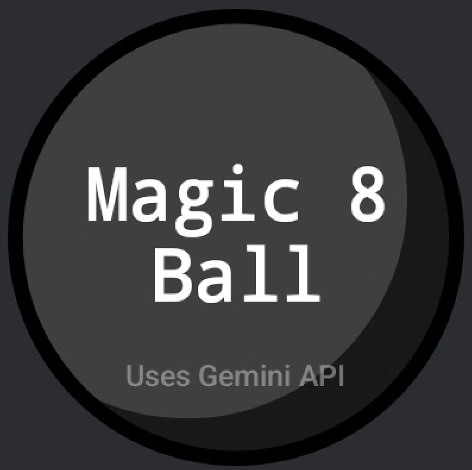
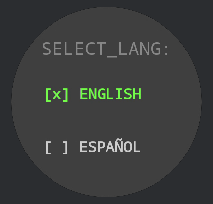
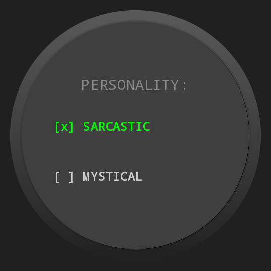

# Magic 8 Ball Wear OS 🎱

**Author:** Lorenzo Suarez

An advanced, AI-powered decision-making companion built exclusively for Wear OS. This application modernizes the classic Magic 8 Ball experience by fusing nostalgic charm with the cutting-edge intelligence of Google's Gemini Large Language Model, all wrapped in a premium, console-inspired interface.

## Overview 🚀

Magic 8 Ball Wear OS goes beyond simple random responses. It features a **Hybrid Intelligence** system that intelligently switches between a local deterministic engine for instant offline answers and a cloud-based Gemini AI for creative, context-aware predictions. The UI is meticulously crafted with physics-based animations, adaptive typography, and a "Matrix-green" console aesthetic that feels right at home on modern smartwatches.

## User Interface & Flow 📸

Experience the complete journey from startup to prediction.

| Splash | Home | Language | AI personality | Reveal |
|:---:|:---:|:---:|:---:|:---:|
|  |  |  |  |  |

### Live Demo


*Real-time physics and API interaction*

*(Please rename your screenshots to match: `splash_screen.png`, `language_selection.png`, `thinking_state.png`, `prediction_result.png`, and `demo.gif`)*

## Key Features ✨

*   **🧠 Hybrid AI Engine**:
    *   **Local Fallback**: Instant, zero-latency responses using a local database when offline.
    *   **Cloud Intelligence**: Taps into the Gemini API for unique, witty, and varied predictions when connected.
    *   **Your Call**: An "AI answers" page lets the user switch AI answers off (or back on) at any time. Gemini is asked only when the user's choice is on, the developer's remote switch is on and a key is available; when AI answers are not available the page says so instead of offering a toggle that does nothing.
    *   **Smart Retry Policies**: Robust network handling with exponential backoff and strict safety filters.

*   **🎨 Premium Wear OS Experience**:
    *   **Physics-Based Animation**: The signature blue triangle floats and settles with realistic spring dynamics.
    *   **Console Aesthetic**: A retro-futuristic language selection screen with monospace typography and green accent highlights.
    *   **Haptic Feedback**: Subtle vibrations enhance the tactile feel of shaking the device or receiving an answer.

*   **📐 Adaptive Typography**:
    *   **Auto-Sizing Text**: `TriangleFittedText` uses a binary search over font sizes to fit predictions of any length perfectly within the inverted triangle geometry without truncation.
    *   **Dynamic Gravity**: Text naturally "floats" to the visual center but adapts its position based on phrase length and triangle width.

*   **🌍 Multi-Language Support**:
    *   Seamlessly toggle between **English** and **Spanish**.
    *   Every text in the app follows the language chosen in the app; on first launch it is Spanish on a Spanish-language watch and English otherwise.
    *   **Dynamic System Prompts**: The AI's personae and language instructions are injected dynamically based on user preference.

*   **💾 Remembers Your Choices**:
    *   Language, personality and the AI answers choice are saved on the watch with Jetpack DataStore and restored before the first frame. Nothing else is stored.

## Tech Stack 🛠️

Built with modern Android development standards and best practices:

*   **Language**: [Kotlin](https://kotlinlang.org/) (v2.0+)
*   **UI Framework**: [Compose for Wear OS](https://developer.android.com/training/wearables/compose) (Material 3)
*   **Architecture**: Clean Architecture + Multi-Module (Modularization by Layer & Feature)
*   **Dependency Injection**: [Hilt](https://dagger.dev/hilt/)
*   **Networking**: [Retrofit](https://square.github.io/retrofit/) + [OkHttp](https://square.github.io/okhttp/)
*   **AI Integration**: [Google Gemini API](https://ai.google.dev/)
*   **Concurrency**: Kotlin Coroutines & Flow
*   **Persistence**: [Jetpack DataStore](https://developer.android.com/topic/libraries/architecture/datastore) (Preferences)
*   **Serialization**: Kotlinx Serialization

## Architecture 🏗️

The project follows a strict **Clean Architecture** pattern, modularized to separate concerns and ensure scalability:

```text
:app-wear           # Wear OS application: entry point & DI orchestration
├── :feature:chat   # Wear presentation layer (UI, ViewModel)
:app-phone          # Phone/tablet application: one Compose (Material 3) screen, its ViewModel & speech recognition
├── :core:domain    # Business logic (UseCases, Repository Interfaces, Policies)
├── :core:data      # Data implementation (Repositories, DataSources, API)
├── :core:network   # Network infrastructure (Retrofit, OkHttp, API Keys)
├── :core:motion    # Sensor logic & Shake detection strategy
├── :core:common    # Shared utilities & configurations
└── :core:designsystem # Wear theming, Color, Type
```

Both applications share `:core:domain`, `:core:data`, `:core:network`, `:core:motion` and `:core:common`, so the bundled answers, the Gemini layer and the shake detection are the same code on the watch and on the phone.

### Phone & tablet app

`:app-phone` is the app for phones and tablets. Its layout follows the listen-and-identify apps people already know: a flat disc with the "8" in the middle that beats slowly, one line above it, and a second page with the history one swipe away, with dots at the top telling which page is in front. It has one dark palette over a soft gradient, whatever the system's theme.

*   **Ask out loud**: hold the ball and say your question; let go to end it. Rings around the ball grow with your voice and the words appear under it. When AI answers are on, the recognised question is what Gemini answers.
*   **Stages**: "Hold to ask" at rest; "Listening…" with the rings; "Thinking…" with ripples leaving the ball; then the ball grows and its "8" gives way to the die with the answer, the question above it. The window comes up as soon as the ball starts thinking, which has two fine borders, with a grey die deep in it, swaying, and a band of light crossing it; with the answer the die floats up until it fills the window, tips, rocks upright as if in liquid, takes the accent colour and shows the text, which is written on the die and moves with it. Colour is kept for the answer: everything else is greys over a near-black blue. The answer stays until you close it or ask again; the close button or the back gesture also cancels a question in progress.
*   **Recents**: the page to the left (swipe, or the button in the corner) lists the answers: answer, question, how long ago and whether it was AI or classic, An entry goes away with a swipe or its delete button, with "Undo" for a moment; "Clear all" sits at the top and asks first. The history is a domain repository (`AnswerHistoryRepository` in `:core:domain`) implemented over one private file (`FileAnswerHistoryRepository` in `:core:data`) and bound only in the phone app; it holds at most 50 entries and is never backed up or sent anywhere.
*   **Or don't**: a short tap asks without a question, and so does shaking the phone (only while the app is on screen and the ball is at rest).
*   **Settings** (one bottom sheet): language (English / Español, switched at once, Spanish by default on a Spanish-language device), answer style (Sarcastic / Mystical / Neutral), AI answers and voice questions. With voice questions off the app is tap-and-shake only. All four are saved with the same DataStore file layout the watch uses.
*   **Microphone**: `RECORD_AUDIO` is requested the first time you ask out loud. If it is denied, or the device has no speech recognition service, the app behaves exactly as with voice questions off; it says so once, never blocks, and the settings sheet offers a way to grant it.
*   **Speech recognition** uses Android's `SpeechRecognizer` behind a domain gateway (`SpeechListener`): the on-device recognizer where the device has one for the app's language (Android 12+), otherwise the device's default recognition service. It runs only while you hold.
*   **Privacy**: when a question was recognised *and* AI answers are in use, the question text (one line, at most 200 characters) is sent to Gemini as the user message so the answer responds to it; the system instruction stays the app's own, tells the model to treat that text only as a question, and answers over 6 words are rejected. A tap or a shake sends the same fixed trigger the watch sends. With AI answers off, unavailable, slow or failing, the answer is a bundled one and nothing is sent. The question and its answer are kept only in the on-device "Recents" history (latest 50, excluded from backups, deletable one by one or all at once). See [the privacy policy](docs/PRIVACY_POLICY.md).
*   **Quality**: animations are drawn in the draw/layer phase only (no recomposition per frame), run at their designed speed whatever the system's animation scale is (the ball is the app, so its motion is a product decision; everything else follows the system setting), and come with haptics; edge-to-edge, one dark palette, portrait on phones and free rotation on tablets and foldables; TalkBack and switch users get "Ask" and "Ask by voice" actions and hear the answer announced.

The watch app shares all of this. Its screen is the ball: a shake asks, and while AI answers are in use (the only thing that can answer a question) holding the screen listens to one, with the words shown under the "8" as they are heard. Speech recognition is a domain gateway (`SpeechListener` in `:core:domain`) implemented once over Android's `SpeechRecognizer` (`AndroidSpeechListener` in `:core:data`) and used by both apps.

`./gradlew :app-phone:recordRoborazziDebug` renders the screen's states on the JVM (no device needed) into `app-phone/build/outputs/roborazzi/`.

### Builds & version codes

Google Play pairs the two apps through the **same `applicationId`** (`com.lorenzosuarez.magiceightball`) and the **same signing key**; the version codes must never collide:

| Module | Version codes | Min SDK | Release build |
|:---|:---|:---|:---|
| `:app-phone` | 1, 2, 3… | 26 | `./gradlew :app-phone:bundleRelease` |
| `:app-wear` | 101, 102, 103… | 30 | `./gradlew :app-wear:bundleRelease` |

Release signing is configured once, in `gradle/release-signing.gradle`, for both modules. The credentials stay outside the repository (`~/.android-keys/magic8ball-keystore.properties` by default; override with `-Pmagic8ball.keystoreProperties=...` or `MAGIC8BALL_KEYSTORE_PROPERTIES`). Without them a release build still succeeds, unsigned.

## Setup & Configuration ⚙️

The app builds and runs with no setup at all: without Firebase it answers from the bundled offline list.

1.  **Clone the Repository**:
    ```bash
    git clone https://github.com/lorenzosuarez/magic-eight-ball.git
    ```

2.  **Enable Gemini from the Firebase console (optional)**:
    *   Create a Firebase project and add an Android app with the package `com.lorenzosuarez.magiceightball`.
    *   Download `google-services.json` into `app-wear/` and `app-phone/` (git-ignored; the same file, since both apps share the package).
    *   In **Remote Config**, add and publish two parameters:

        | Parameter | Type | Meaning |
        |:---|:---|:---|
        | `gemini_enabled` | Boolean | Turns Gemini answers on or off for everyone. Off when missing. Each user can still switch AI answers off in the app. |
        | `gemini_api_key` | String | The Gemini API key from [Google AI Studio](https://aistudio.google.com/). |
        | `gemini_model` | String | Optional Gemini model ID. Defaults to `gemini-3.5-flash-lite`; change it here when Google retires a model. |

    The app checks Remote Config at launch and at most once an hour, so a change can take up to an hour to reach a watch. Values in Remote Config can be read by anyone with the app, so restrict the key to the Generative Language API and set a quota.

3.  **Local key for debug builds (optional)**:
    `GEMINI_API_KEY=...` in the git-ignored `local.properties` is compiled into **debug** builds only and is used when Remote Config provides no key. Release builds never embed a key.

4.  **Build & Run**:
    Open the project in Android Studio (Koala or later recommended) and deploy `app-wear` to a Wear OS emulator or watch, or `app-phone` to a phone or tablet (`./gradlew :app-wear:assembleDebug` / `./gradlew :app-phone:assembleDebug`).

## License 📄

Copyright © 2024 **Lorenzo Suarez**. All rights reserved.
